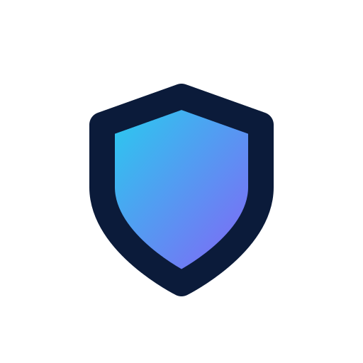

<div align="center">

<picture>
  <source media="(prefers-color-scheme: dark)" srcset="docs/logo-dark.png">
  
</picture>

# 🛡️ DNC VPN

**Fast, free VPN client for Android — tuned for Iranian networks**

[](https://github.com/0xAKIRAVX/DNC-VPN/releases/latest)
[](#-free-built-in-subscriptions)
[](#-download--install)
[](https://0xakiravx.github.io/DNC-VPN/)

📢 Telegram channel: **[@OxAKIRAVX](https://t.me/OxAKIRAVX)**

</div>

---

## 📲 Download & install

- **APK (arm64-v8a, ≈ 62 MB):** get the latest build from [Releases](https://github.com/0xAKIRAVX/DNC-VPN/releases/latest) — or the [Picofile mirror](https://www.picofile.com/f/a7CUujsiUS/DNC-VPN-1.8.6-arm64-v8a-apk.zip) if GitHub is hard to reach
- Requires **Android 7+**
- Installs on top of any older DNC build — **no uninstall needed** (same signature)

> [!TIP]
> If the in-place upgrade fails, remove the old app once and install again.

**Latest build:**

| Build | Arch | Size | MD5 |
|---|---|---|---|
| v1.8.7 | arm64-v8a | ≈ 62 MB | `c94eb759bb465a1762ea5013f6913604` |

## 🚀 Free built-in subscriptions

Three internal groups, refreshed automatically. The app also refreshes the list every time you open it, or on demand with <kbd>Update</kbd>.

| Group | Contents | Best for |
|---|---|---|
| **Selected** 🏆 | **speed-tested picks** — every config is verified through a real tunnel (connectivity → download → upload) and re-tested **every 3 hours** | the best of the crop: low ping, high speed |
| **Free** 🥇 | **SS44 GOLD** — configs that passed a **real-traffic test**, ranked for Irancell + operator-filtered **Reality** configs (MCI / Irancell / Rightel) | quick start, fewest `-1` pings |
| **Free Extra** | everything in Free + the tested **Eternity** list (more variety) | when Free is congested |

**Aggregation sources** (priority order inside the list):

1. [SS44 GOLD](https://github.com/ZendanTeam/SS44-sub) — TCP + real-traffic testing, Reality / port-443 ranked first, updates every 30 minutes
2. [My-Clean-Configs](https://github.com/Mojtaba1423/My-Clean-Configs) — surgically filtered Reality configs for Iranian operators (TCP + TLS-handshake tests)
3. [V2RayAggregator / Eternity](https://github.com/mahdibland/V2RayAggregator) — Extra list only, tested upstream

<details>
<summary><b>📡 Use the feeds in any other client</b> — v2rayNG / Hiddify / NekoBox / Streisand</summary>

<br>

```
https://raw.githubusercontent.com/0xAKIRAVX/DNC-VPN/main/sub-selected.txt
https://raw.githubusercontent.com/0xAKIRAVX/DNC-VPN/main/sub.txt
https://raw.githubusercontent.com/0xAKIRAVX/DNC-VPN/main/sub-extra.txt
```

</details>

## 🔧 Fixing a `-1` ping

Work through this list in order:

1. In the **Free** group, tap <kbd>Update</kbd> — configs rotate every 5 minutes, so last night's list is dead today
2. Run `⋮ → Test all` and sort by ping — **the top of the list (Reality / port 443) has the best odds**
3. **Irancell:** in settings, test **Fragment** once on and once off
4. Keep your phone clock on **Automatic** — a wrong clock fails every TLS / Reality handshake
5. If every TCP config is locked, tap <kbd>Update</kbd> again a few minutes later — the list never goes stale

> [!TIP]
> On v1.8.7 and newer, updating from an older build automatically re-points the **Free Extra** group to the current source — the old "toggle Show free subscription off/on" workaround is no longer needed.

## 🧭 Modes — which config should I pick?

| Mode | Use it when | Notes |
|---|---|---|
| **VLESS + Reality** (port 443) | first choice on every operator | looks like ordinary TLS traffic — best odds against DPI |
| **VMess / ws + TLS over CDN** (443 / 2053 / 2083 / 2087 / 2096) | direct server IPs are blocked | rides through a CDN |
| **Trojan** | a light, stable fallback | prefers port 443 |
| **SS** | speed on a good day | gets detected at busy hours |
| **Hysteria2 / TUIC** (UDP) | your network allows UDP | most Iranian networks throttle UDP |
| **Fragment** (TLS fragmentation) | Irancell, when all else fails | in settings — test both on and off |

> [!NOTE]
> The in-app ping test measures **TCP only**. A config that pings but won't load pages is dead — switch to the next one.

## 🔒 Privacy

- DNC VPN sends **no data** to any server of ours — the config list is read straight from GitHub
- Your traffic passes through **public, volunteer-run servers**: fine for everyday browsing, but for sensitive work (banking, your main email) use your own server
- Full policy: **[CR.md](CR.md)**

> [!WARNING]
> Free servers can see unencrypted application-layer traffic (DNS / HTTP). Do not use them for banking, purchases or two-factor logins.

---

<div align="center">

**DNC VPN** · 📢 Telegram: **[@OxAKIRAVX](https://t.me/OxAKIRAVX)** · 🌐 [Website](https://0xakiravx.github.io/DNC-VPN/)

</div>
